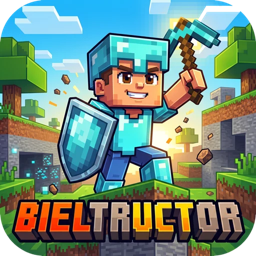
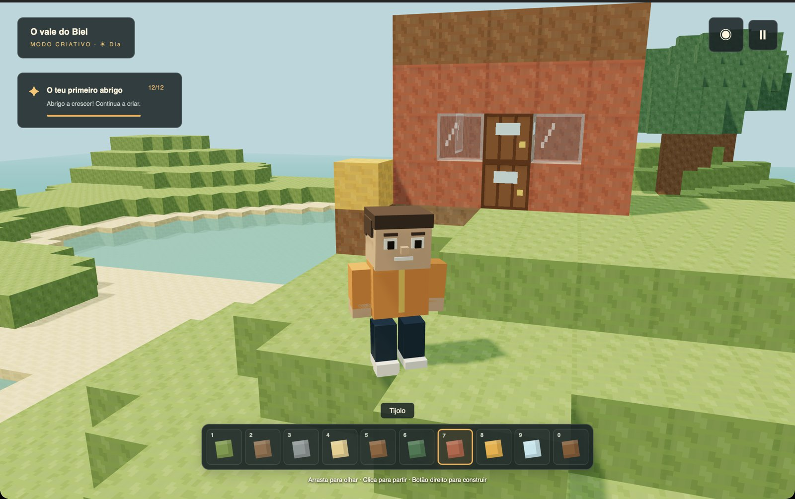
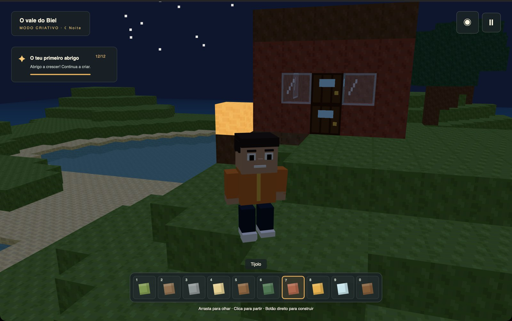
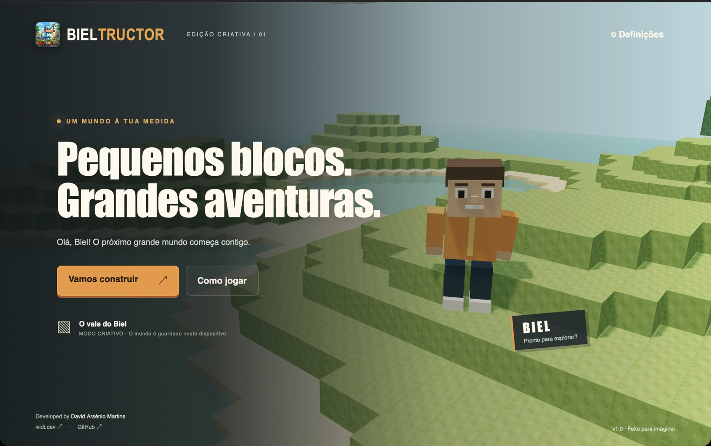
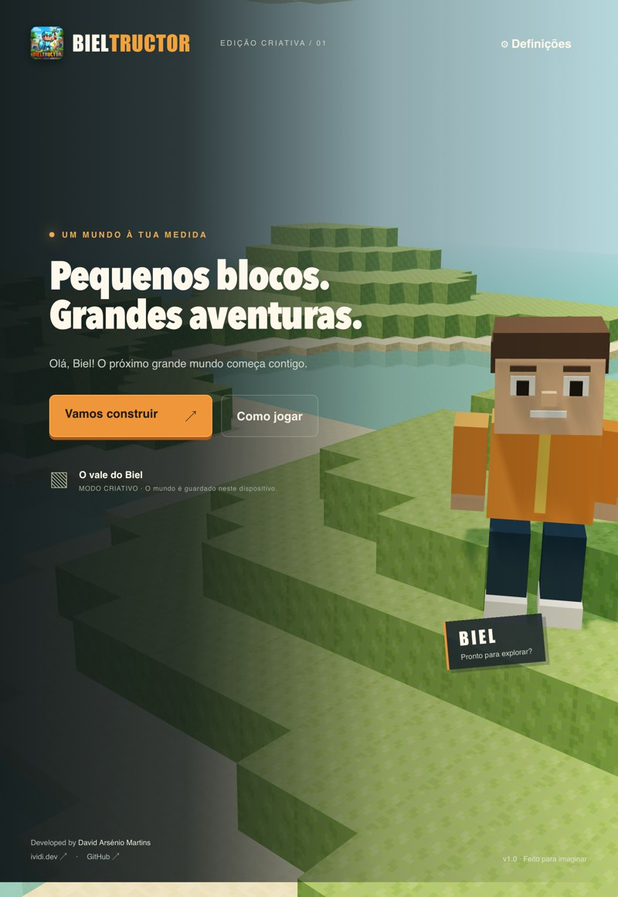
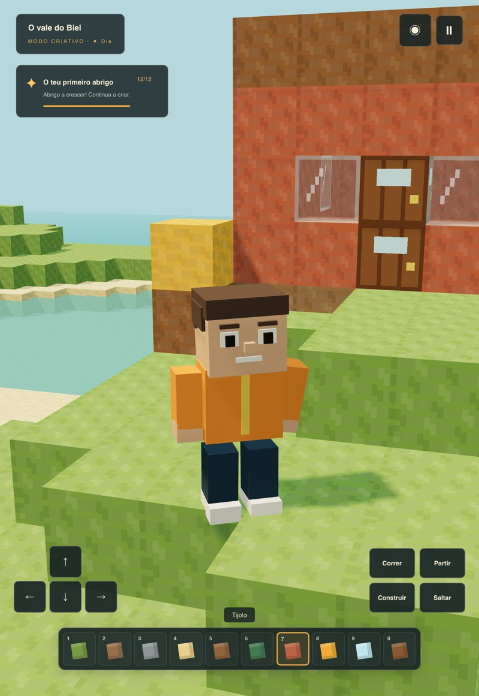

<p align="center"></p>

# Bieltructor 🧱

> A voxel adventure for macOS, iPad and iPhone, starring Biel. Explore seeded islands with biomes and caves, build in Creative mode, or gather, craft, farm, make animal friends and get through the night in Adventure mode, on a difficulty made for young players.

[](https://github.com/VidiPT89/Bieltructor)
[](https://github.com/VidiPT89/Bieltructor)
[](https://github.com/VidiPT89/Bieltructor/issues)
[](https://github.com/VidiPT89/Bieltructor/issues)

<p align="center">
  
</p>
<p align="center">
  
  
</p>
<p align="center">
  
  
</p>

## ✨ Features

**Worlds and modes**
- ✅ Up to six saved worlds, each with its own name, mode, size, seed and options; a picture of each island before it is created, and every world in the list can be renamed, duplicated, exported and deleted
- ✅ Islands in three sizes (57, 97 or 129 blocks across) made from a seed, or the original **Classic valley**
- ✅ Biomes: plains with flowers, forests, beaches, deserts with cacti, snowy mountains with spruces and ice, swamps with mushrooms; winding caves underground, with lakes on the cave floor
- ✅ Block-by-block light (0 to 15): sunlight falls in and fades into caves, torches, lanterns, campfires, glowstone, furnaces and lava light up their surroundings, and monsters only appear where it is dark
- ✅ **Adventure** (gather, craft, survive) or **Creative** (every block, no dangers, fly with a double tap on Jump)
- ✅ Four difficulties plus switches for monsters, animals, "animals only friends", hunger, weather, keeping the backpack, day and night and the day length
- ✅ Older worlds open without losing a single block

**Building, crafting and farming**
- ✅ More than 70 blocks, from grass and glass to doors, beds, torches, lanterns, campfires (the rain puts them out), chests, furnaces, stone bricks, glowstone, red sand, cobblestone, beds in seven colours, four kinds of flowers and copper, iron and gold blocks
- ✅ Building shapes: ladders to climb, fences, gates and trapdoors that open, signs you can write on and flower pots; wool in eight colours from dyes, and sheep that can be dyed
- ✅ Pickaxes, swords, axes, shovels and hoes in wood, stone, iron and crystal, each fast on its own blocks; shears, buckets and bottles
- ✅ Gentle tool wear on Normal and Hard only: a small bar under the tool, a friendly warning when it is nearly worn out and a kind message when it is gone
- ✅ Real water: buckets scoop and pour it, it falls and spreads a few blocks and dries up without its source; Biel swims in it
- ✅ Lava deep in the caves of new islands: it glows, flows one block, turns into stone under water and fits in a bucket. It burns on Normal and Hard; on Peaceful and Easy it is warm magma that only nudges Biel out, and it never sets anything on fire
- ✅ Coal, copper, iron, gold and rare blue crystal underground; a furnace melts ores into bars and cooks food
- ✅ Backpack with a 9-slot hotbar and 27 more slots (tap or drag to move, the same items stack up, split a stack in half), chests with 27 slots, and a visual recipe book (ingredients turn green when you have them)
- ✅ A workbench with nine squares: put things in, see what they make and tap to craft. Positions do not matter, the recipe book can fill the squares, and when the same things make two tools (a pickaxe or an axe) both are offered
- ✅ A small farm: till soil with a hoe, grow wheat, carrots and potatoes (faster near water or in the rain), bake bread; a fishing rod to catch fish
- ✅ Ruins and cabins on the islands, each with a treasure chest, and wells in the plains
- ✅ A bow that shoots further and harder the longer it is drawn, a shield that stops half of a hit from the front (all of it when held up), and a golden apple that heals

**Life on the island**
- ✅ Original animated voxel character, Biel
- ✅ Hearts, food and air in Adventure; damage, hunger and falls (above four blocks) follow the difficulty, and falling asleep is gentle
- ✅ Beds become home and sleeping skips the night
- ✅ Friendly chickens, cows, sheep, pigs and rabbits; a dog, a cat and a horse that become friends (and the horse can be ridden); babies when two animals are fed; with "animals only friends" switched off (it starts on for Peaceful and Easy), pigs, cows, chickens and sheep can be caught for food and vanish in sparkles; birds in the sky, bees around their nests (a bottle collects honey) and fish in the sea; on the islands each animal starts in the biome it likes
- ✅ Silly night monsters (the Sleepy sleepwalker, the bouncy Jelly, the Bony archer, the woolly Spider that climbs walls, Puffy who goes PUF and the mist Ghost of the caves) that never appear on Peaceful and vanish in sparkles at sunrise; torches and lanterns keep them away, and Puffy never breaks anything Biel built
- ✅ Day and night, sunsets, stars, rain, snow in the cold biome and gentle thunderstorms (Normal and Hard only)

**Helping young players**
- ✅ Optional guided tutorial in new Adventure worlds
- ✅ Twelve challenges with stickers in a sticker book shared by every world, and a happy note the first time Biel places a torch, builds a workbench, finds coal, iron or a crystal, makes a pickaxe or sees lava
- ✅ A parents' corner behind a simple question: break reminder, highest difficulty allowed and monsters always off
- ✅ A minimap with a compass to home, and a map of the whole island in the pause menu
- ✅ Large text option, icons instead of words on the game buttons for children who do not read yet, tips on the intro screen and separate volumes for music, effects and ambience
- ✅ Sounds made live: footsteps that change with the ground, a voice for every animal and silly voices for monsters, doors, chests and the furnace, and slower, echoing music in caves

**Everywhere**
- ✅ Mac, iPad and iPhone with the same menus, rules and saves; layouts for iPhone in portrait and landscape
- ✅ Keyboard and mouse, multi-touch, and PlayStation, Xbox and MFi controllers (menus too)
- ✅ On touch screens, a Mine / Build switch: keep a finger on a block to mine it, or tap to build and to open doors and chests
- ✅ Optional iCloud sync of worlds between devices, asking before overwriting anything; JSON export and import always available
- ✅ Portuguese (Portugal) and English, Dark, Light and System appearance with the iVidi.dev palette
- ✅ Calm background music generated live, two quality levels picked automatically on first run, 30 fps in Low Power Mode, fully offline

## 🛠️ Tech Stack

| Category | Technology |
|----------|------------|
| macOS application | Swift, AppKit, WebKit |
| iOS / iPadOS application | Swift, UIKit, WebKit |
| Game controllers | GameController framework (native), Gamepad API (browser) |
| Sync | iCloud Drive (ubiquity container), optional |
| Game renderer | Three.js / WebGL, chunked instanced meshes |
| Music and sound | Web Audio API (generated live, no audio files) |
| Game logic and interface | JavaScript, HTML, CSS |
| Build tools | Vite, Swift compiler, Xcode, XcodeGen |
| Tests | Node.js test runner, integrated WebKit smoke tests and XCUITest |
| Code layout | `src/main.js` (game loop and screens), `src/input/` (one action list for keyboard, touch and controllers), `src/persistence.js` (saving and iCloud), `src/ui/html.js`, `src/sounds.js` (footsteps and animal voices), `src/dev/smoke-tests.js`, plus small rule modules (world, lighting, water, items, recipes, creatures, monsters...) |
| Minimum system | macOS 13 / iOS and iPadOS 16 |

## 🚀 Quick Start

### Play on Mac

Build the application as described below, then open `build/Bieltructor.app`. The built app includes its game assets and does not require Node.js, a browser window or an Internet connection to play.

### Build from source

Prerequisites: macOS 13+, Xcode Command Line Tools (or Xcode), Node.js 22.12+ and npm.

```bash
git clone https://github.com/VidiPT89/Bieltructor.git
cd Bieltructor
npm ci
npm run build:macos
open build/Bieltructor.app
```

The script builds for the current Mac architecture and applies an ad-hoc signature for local use. Public distribution requires Developer ID signing and notarization, which are not part of this local build.

### Play on iPad or iPhone

Prerequisites: Xcode, Node.js 22.12+, npm and [XcodeGen](https://github.com/yonaskolb/XcodeGen).

```bash
npm ci
npm run prepare:ios
open Bieltructor.xcodeproj
```

Select **Bieltructor-iOS**, choose your Apple development team under **Signing & Capabilities**, connect the iPad and run. Installation on a physical device requires your signing team and a provisioned device. No App Store or TestFlight upload is included.

Use the directional buttons to walk, **Run** to move faster and **Jump** to jump. Hold movement with one finger while dragging the scene with another to look around. The button at the top switches between ⛏️ **Mine** (keep a finger on a block to break it) and 🧱 **Build** (tap where the block should go); the **Break** and **Build** buttons work as well. Tap an animal to use it and a monster to attack it. The hotbar slots choose what Biel holds, and 🎒 opens the backpack and recipes. Settings includes **Import world** and **Export world**, both integrated with Files; an imported file becomes a new world.

The game and bundled assets work offline. Mac, iPad and browser saves are independent; use JSON export/import to transfer a world. Run `npm run prepare:ios` after changing the shared game before rebuilding in Xcode. `project.yml` is the source of the generated Xcode project.

### Browser development

```bash
npm run dev
```

Open the local address printed by Vite. Browser saves and macOS app saves are separate; export and import a world to move it between them.

## 📖 Controls

| Action | Mac | iPad / iPhone | Controller |
|--------|-----|---------------|------------|
| Move / run | W A S D or arrows, Shift to run | Arrow buttons, Run | Left stick (all the way to run) |
| Look around | Drag the scene | Drag the scene | Right stick |
| Jump / swim up | Space | Jump | A |
| Fly (Creative) | Double tap Space, C to go down | Double tap Jump, Down | Double tap A, B |
| Break | Click (hold in Adventure) | ⛏️ mode: keep a finger on the block (or tap it, then hold Break) | Right trigger |
| Build, eat, open, sleep, use an animal or a tool (bucket, bottle, shears) | Right-click or Shift + click | 🧱 mode: tap the spot (or tap it, then Build) | Left trigger |
| Attack | Click the monster or F | Tap the monster, or Attack | X |
| Hotbar | 1–9 or the mouse wheel | Tap the slot | Shoulder buttons |
| Backpack and recipes | E | 🎒 | Y |
| Get off the horse | C | Down | B |
| Pause / menus | Escape | Ⅱ | Menu, then the d-pad, A and B |
| Draw and shoot the bow, or hold up the shield | Hold and release the right button | Hold and release Build | Hold and release the left trigger |
| Performance numbers | F3 | Triple tap with two fingers | |
| New world · Export · Settings | ⌘N · ⌘E · ⌘, | | |

The bottom layer is protected. Use **Return to spawn** in the pause menu if you get lost. A simple guide in Portuguese for Biel and for parents lives in [`docs/GAMEPLAY.pt.md`](docs/GAMEPLAY.pt.md).

## ☁️ iCloud and distribution

iCloud sync is off by default (Settings › Save to iCloud). It needs the **iCloud** capability with the container `iCloud.dev.ividi.bieltructor` on the App ID, which comes with a paid Apple Developer account. Without it, or without an iCloud account, the game says iCloud is not available and keeps saving locally; worlds can always move between devices with **Export world** and **Import world**.

Each world is one JSON file in iCloud Drive. A save only replaces the file if it is still the version the game listed. The check and the write happen inside one `NSFileCoordinator` write, so a change made meanwhile by another device is never overwritten; the game simply looks again a few seconds later. Deleting a world leaves a small marker file (`{ id, deleted, updatedAt }`), so the other devices delete it too instead of sending it back. A world played on a device after it was deleted elsewhere is kept and goes back up.

- **TestFlight (iPad and iPhone):** `TEAM_ID=XXXXXXXXXX scripts/release-ios.sh` archives the app and exports an `.ipa`. It does not upload: send it with Transporter or `xcrun altool`.
- **Mac outside the App Store:** `TEAM_ID=XXXXXXXXXX scripts/release-macos.sh` archives the **Bieltructor-macOS** target and signs it with Developer ID (hardened runtime). Notarization only runs with `--notarize` and a `notarytool` keychain profile in `NOTARY_PROFILE`.
- One bundle identifier (`dev.ividi.bieltructor`) and version (2.0.0, build 2) for every platform, set in `project.yml`. The Mac stays a native AppKit app rather than Mac Catalyst: it is already small and simple, and the game itself is shared.

## 🎨 App icon

The logo lives in `docs/Bieltructor_logo.jpeg`. After changing it, run `npm run icons` (Python 3 with Pillow) to regenerate the macOS `.icns`, the iOS app icon, the in-game logo and the favicon.

## 🧪 Testing

```bash
npm test
npm run build
npm run build:macos
npm run build:ios
# In Xcode: pick an iPad or iPhone simulator, then Product > Test.
```

The unit suite (134 tests) covers terrain and seeds, biomes, caves, ores and the newer island features (copper, lakes, wells and bee nests, only in new worlds), block lighting, flowing water and lava, collisions, saved worlds and their migration, difficulty rules, stacking, tool families and wear, recipes, smelting and treasure, health and hunger, animals, babies, taming, riding and shearing, monster rules (including "never on Peaceful" and "never when switched off"), crops, weather, challenges, the tutorial, the parents' rules, the input action layer and controller mapping, moving and splitting stacks, the shield and bow draw, footstep and animal sounds, the HTML helpers, iCloud sync decisions and the music generator, and that Portuguese and English have the same texts with no key written twice, that the seeded random rolls repeat, and that every recipe, furnace, treasure, animal and monster only names items that exist. The integrated smoke suite (218 checks in `src/dev/smoke-tests.js`, shared by the Mac and iOS apps) plays through worlds, building and building shapes, crafting, farming, fishing, survival, animals, monsters, weather, chests and the furnace, the tutorial and stickers, the parents' corner, a seeded island drawn in chunks, block lighting, tools and wear, buckets and flowing water, lava (bucket, burning on Normal, warm on Easy, cooled by water), campfires and rain, honey and shears, bees, a game controller, the minimap and map, volumes, the bow and arrows, the shield, world pictures, joining and splitting stacks in the backpack, the nine squares of the workbench, mining with a finger and building with a tap, icons instead of words, every monster and iCloud sync with a pretend iCloud. The UI test drives the touch controls in landscape and portrait and passes on iPad and iPhone simulators. Run a built application with `--smoke-test` in a graphical Mac session; it uses an isolated temporary data store and writes its result to `/tmp/biel-smoke-result.txt`. iOS simulator tests need the Mac's display awake (with the lid closed, WebGL in the simulator loses its graphics context).

## Current scope

The main systems from the v2 brief are implemented, with simplifications and outstanding device validation. See the [roadmap](docs/ROADMAP.md) for where each phase of the v3 plan stands, the [latest audit](docs/AUDIT-2026-11-09.md) for confirmed fixes and remaining work, and the [phase-by-phase history](docs/REVIEW-2026-11-09.md) for implementation details.

Bieltructor is a single-player game. Multiplayer and an endless world are outside its scope (islands go up to 129 × 129). Implementation does not establish full acceptance of every requirement. One compatibility difference is: the medium and large islands are 97 and 129 blocks across rather than 96 and 128, because islands are built around a centre block (like the 57 × 57 small island the brief asks for), and changing their size would reshape every island that already exists. World pictures stay on the device where they were taken; they are not synced with iCloud. The Mac build runs its integrated tests on Apple Silicon and the iOS build is tested on iPad and iPhone simulators. Intel Macs, physical devices, real controllers, real iCloud sync between devices and the signed release scripts still need to be tried with a real Apple Developer account.

## 📄 License

Distributed under the MIT License. See [LICENSE](LICENSE) for details.

## 👨‍💻 Author

**David Arsénio Martins**

- 🌐 Website: [ividi.dev](https://ividi.dev/)
- 🐙 GitHub: [@VidiPT89](https://github.com/VidiPT89/)

Bug reports and feature requests are welcome on the [issues page](https://github.com/VidiPT89/Bieltructor/issues).

---

<p align="center">Developed by <a href="https://ividi.dev/">David Arsénio Martins</a></p>
<p align="center">⭐ If you like this project, give it a star!</p>
