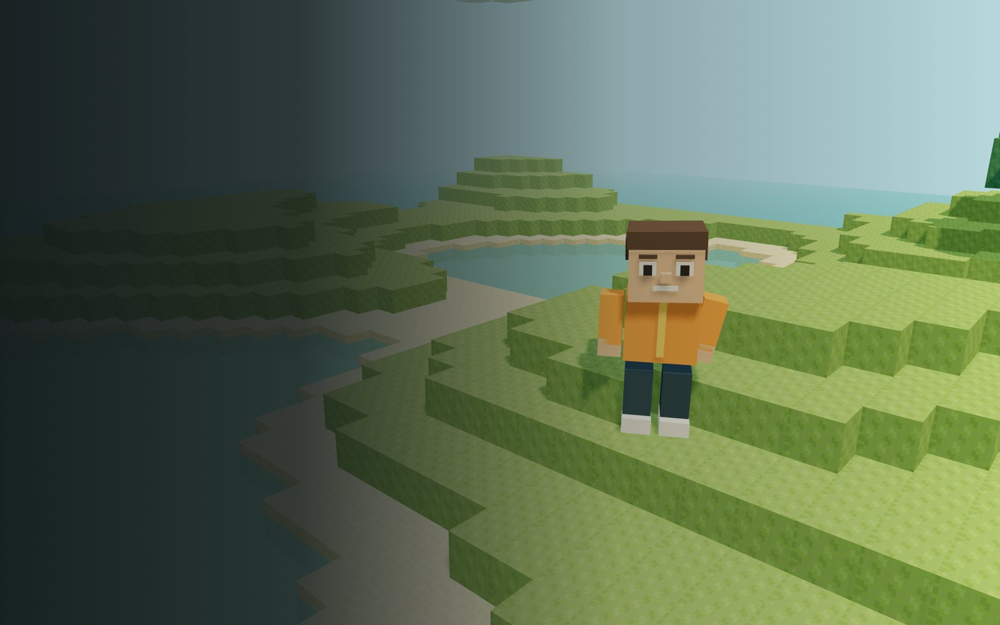

<p align="center"></p>

# Bieltructor 🧱

> A creative voxel adventure for macOS, iPad and iPhone, starring Biel. Explore a peaceful block world, build your own shelter and turn little blocks into big adventures.

[](https://github.com/VidiPT89/Bieltructor)
[](https://github.com/VidiPT89/Bieltructor)
[](https://github.com/VidiPT89/Bieltructor/issues)
[](https://github.com/VidiPT89/Bieltructor/issues)

<p align="center">
  
  
</p>

## ✨ Features

- ✅ Original animated voxel character, Biel, with an orange explorer jacket and backpack
- ✅ A 3D island with hills, trees, sandy shores, animated water and drifting clouds
- ✅ Creative building with eight materials: grass, dirt, stone, sand, wood, leaves, brick and amber
- ✅ Break and place blocks with particle effects and synthesized sounds
- ✅ Walking, running, jumping, swimming, gravity, collisions and first/third-person views
- ✅ Crosshair aiming in first person with a mouse, tap-to-select on touch screens
- ✅ A first-shelter building challenge that counts the blocks still standing
- ✅ Automatic local saving of the world and of Biel's position and camera
- ✅ JSON import and export through native file dialogs, plus a two-step "Start a new world" reset
- ✅ Portuguese (Portugal) and English, selectable in Settings
- ✅ Dark, Light and System appearance, with the iVidi.dev orange, burnt yellow and black palette
- ✅ Animated introduction with the game logo and developer credits (tap or press a key to skip), followed by the main menu
- ✅ Standalone macOS window with full-screen support, application icon and offline gameplay
- ✅ Sound controls and two quality levels (Light turns shadows off for older devices)
- ✅ iOS/iPadOS app with multi-touch movement, jumping, camera control and native Files import/export
- ✅ Portrait and landscape layouts, safe-area support and automatic pause when leaving the app

## 🛠️ Tech Stack

| Category | Technology |
|----------|------------|
| macOS application | Swift, AppKit, WebKit |
| iOS / iPadOS application | Swift, UIKit, WebKit |
| Game renderer | Three.js / WebGL |
| Game logic and interface | JavaScript, HTML, CSS |
| Build tools | Vite, Swift compiler |
| Tests | Node.js test runner and integrated WebKit smoke tests |
| Minimum system | macOS 13 / iOS and iPadOS 16 |

## 🚀 Quick Start

### Play on Mac

Build the application as described below, then open `build/Bieltructor.app`. The built app includes its game assets and does not require Node.js, a browser window or an Internet connection to play.

### Build from source

Prerequisites: macOS 13+, Xcode Command Line Tools (or Xcode), Node.js 22.12+ and npm.

```bash
git clone https://github.com/VidiPT89/Bieltructor.git
cd Bieltructor
npm ci
npm run build:macos
open build/Bieltructor.app
```

The script builds for the current Mac architecture and applies an ad-hoc signature for local use. Public distribution requires Developer ID signing and notarization, which are not part of this local build.

### Play on iPad or iPhone

Prerequisites: Xcode, Node.js 22.12+, npm and [XcodeGen](https://github.com/yonaskolb/XcodeGen).

```bash
npm ci
npm run prepare:ios
open Bieltructor.xcodeproj
```

Select **Bieltructor-iOS**, choose your Apple development team under **Signing & Capabilities**, connect the iPad and run. Installation on a physical device requires your signing team and a provisioned device. No App Store or TestFlight upload is included.

Use the directional buttons to walk, **Run** to move faster and **Jump** to jump. Hold movement with one finger while dragging the scene with another to look around. Tap a nearby block to select it, then choose **Break** or **Build**. Material buttons select the block to place. Settings includes **Import world** and **Export world**, both integrated with Files. Import replaces the current world, so export it first if you want to keep it.

The game and bundled assets work offline. Mac, iPad and browser saves are independent; use JSON export/import to transfer a world. Run `npm run prepare:ios` after changing the shared game before rebuilding in Xcode. `project.yml` is the source of the generated Xcode project.

### Browser development

```bash
npm run dev
```

Open the local address printed by Vite. Browser saves and macOS app saves are separate; export and import a world to move it between them.

## 📖 Controls

| Action | Control |
|--------|---------|
| Move | W A S D or arrow keys |
| Run | Shift + movement |
| Jump / swim up | Space |
| Look around | Drag the scene |
| Break a block | Left-click a nearby block (in first person, the block under the crosshair) |
| Place a block | Right-click, or Shift + click |
| Select material | 1–8 or click the inventory |
| Change perspective | V or the camera button |
| Pause | Escape or the pause button |
| Full screen | Control + Command + F |

Building has a seven-block reach. Water is shallow, but holes dug below the waterline fill with water: hold Space to swim up. The bottom layer is protected. Use **Return to spawn** in the pause menu if you need to find your way home. Export a world from Settings to keep a backup before importing another world.

## 🎨 App icon

The logo lives in `doc/Bieltructor_logo.jpeg`. After changing it, run `npm run icons` (Python 3 with Pillow) to regenerate the macOS `.icns`, the iOS app icon, the in-game logo and the favicon.

## 🧪 Testing

```bash
npm test
npm run build
npm run build:macos
npm run build:ios
# In Xcode: select an iPad simulator, then Product > Test.
```

The unit suite checks deterministic terrain, the protected floor, spawn clearance, collision boundaries, saved-world and saved-position validation, independent fingers and clearing held touch controls. The integrated smoke suite (23 checks, shared by the Mac and iPad apps) covers rendering, language, appearance, movement, jumping, swimming, block placement/removal, the quest counter, notifications, perspective, persistence, multi-touch, pause/resume and the two-step world reset. The iPad UI test also drives the touch controls in landscape and portrait. Run a built application with `--smoke-test` in a graphical Mac session; it uses an isolated temporary data store and writes its result to `/tmp/biel-smoke-result.txt`.

## Current scope

Bieltructor is a single-player creative sandbox with a finite 57 × 57 block world, eight building materials and one building challenge. It does not yet include survival combat, crafting, multiplayer or an infinite world. World edits, Biel's position and the camera are saved locally. The macOS build has been compiled and its integrated tests run on Apple Silicon. The iOS/iPadOS build has been tested on the iPad Pro 11-inch simulator, including touch movement, jumping, building and both orientations. Intel Macs and physical iPads/iPhones have not been tested yet.

## 📄 License

Distributed under the MIT License. See [LICENSE](LICENSE) for details.

## 👨‍💻 Author

**David Arsénio Martins**

- 🌐 Website: [ividi.dev](https://ividi.dev/)
- 🐙 GitHub: [@VidiPT89](https://github.com/VidiPT89/)

Bug reports and feature requests are welcome on the [issues page](https://github.com/VidiPT89/Bieltructor/issues).

---

<p align="center">Developed by <a href="https://ividi.dev/">David Arsénio Martins</a></p>
<p align="center">⭐ If you like this project, give it a star!</p>
